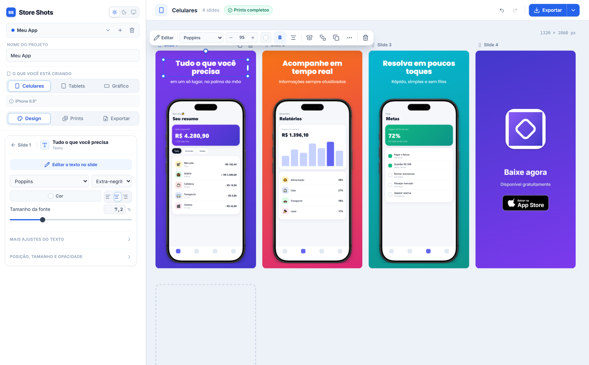
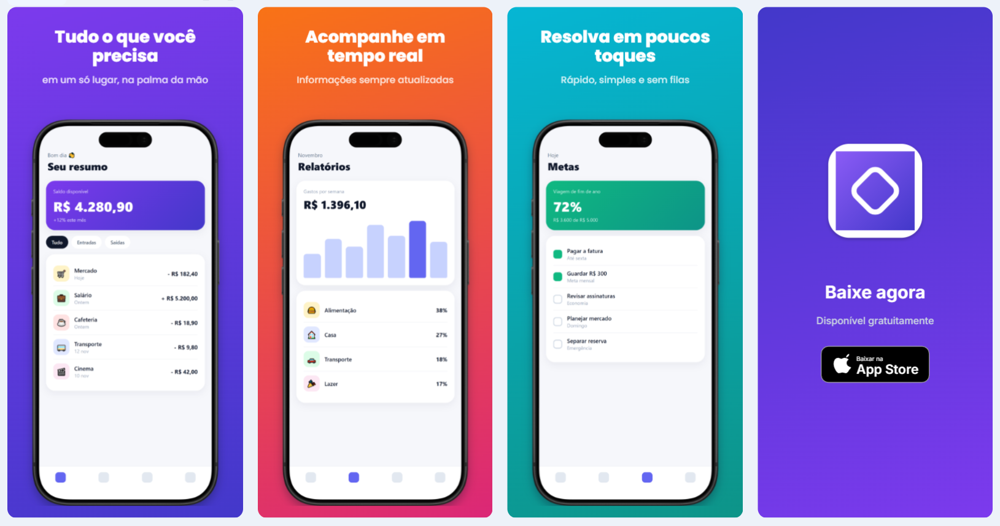

# Store Shots

Monte as capturas da **App Store** e da **Play Store** (celulares e tablets) e o **recurso gráfico** da Play Store a
partir dos prints do seu app — com modelos prontos, textos, imagens e molduras de aparelho.

Roda **inteiro no navegador**: nenhum print ou projeto sai do seu computador.



<p align="center"><em>Resultado: os quatro slides prontos para exportar.</em></p>



## Destaques

- **Edição direto no slide** — clique para selecionar; uma barra flutuante traz excluir, duplicar, alinhar, colocar em
  todos os slides e o essencial de cada tipo (fonte, tamanho e cor do texto; trocar imagem; print do aparelho).
  Clique duplo edita o texto ali mesmo.
- **Seleção múltipla, até entre slides** — Shift + clique ou arraste uma área; mova, alinhe, copie ou exclua tudo junto.
- **Copiar e colar como no Figma** — Ctrl+C numa camada, clique em outro slide, Ctrl+V. Ou "Colocar em todos os
  slides" (ideal para logo), sem empilhar cópias repetidas.
- **22 modelos** — 14 para celular/tablet e 8 para o recurso gráfico. Depois de aplicado, tudo continua editável.
- **Fundos** — cor sólida, degradê, radial e aurora (manchas de cor suaves), com 20 fundos prontos.
- **Prints bem enquadrados** — remoção automática da barra de status e da pílula de gestos, área segura abaixo da
  câmera, zoom e posição.
- **Exportação aceita pelas lojas** — tamanhos exatos de cada loja ou personalizados, PNG **sem canal alfa** (a App
  Store recusa transparência) ou JPG, em `.zip` ou direto numa pasta.

## Começando

Requer Node.js 20 ou mais novo.

```bash
npm install
npm run dev        # http://localhost:3000
```

Use **Chrome ou Edge**: "Salvar em uma pasta" usa a File System Access API. Nos outros navegadores a exportação sai
em `.zip`.

| Comando | O que faz |
|---|---|
| `npm run dev` | Servidor de desenvolvimento. |
| `npm run build` | Gera o site estático em `out/` — dá para hospedar em qualquer lugar. |
| `npm start` | Serve a pasta `out/`. |
| `npm test` | Testes do núcleo (modelos, migração, geometria, alinhamento, detector, PNG). |
| `npm run lint` / `npm run typecheck` | ESLint e TypeScript. |

## Como usar

1. **Crie um projeto** e escolha o que vai criar: **Celulares**, **Tablets** ou **Gráfico** (recurso gráfico da Play
   Store, 1024 × 500).
2. **Escolha um modelo** em *Design → Modelo → Trocar*. As prévias já usam os seus prints.
3. **Envie os prints**: arraste os arquivos para cima de um slide (vários de uma vez entram em ordem de nome) ou
   clique no aparelho vazio. Ajuste o enquadramento na aba **Prints**.
4. **Edite no slide**: clique duplo no texto para reescrever; arraste, redimensione e gire pelas alças. Adicione
   texto, imagem, aparelho, selo da loja ou forma em *Design → Slide*.
5. **Organize os slides**: arraste o cabeçalho "Slide N" (ou pressione e segure o fundo do slide) para mudar a ordem.
6. **Exporte**: marque os tamanhos na aba **Exportar** e clique em **Exportar** no topo.

A barra lateral tem três abas — **Design**, **Prints** e **Exportar**. Com uma camada selecionada, a aba Design mostra
só as propriedades dela (o menos usado fica recolhido em "Mais ajustes").

## Atalhos

| Atalho | Ação |
|---|---|
| Clique duplo / Enter | Editar o texto no slide (Esc ou clicar fora termina) |
| Shift / Ctrl + clique | Somar ou tirar uma camada da seleção (vale entre slides) |
| Arrastar no fundo do slide | Selecionar por área |
| Ctrl + A | Selecionar todas as camadas do slide |
| Ctrl + C / Ctrl + X / Ctrl + V | Copiar, recortar e colar camadas no slide selecionado |
| Ctrl + D | Duplicar |
| Delete | Excluir |
| Setas (Shift = passo maior) | Mover |
| Shift ao girar | Girar de 15 em 15° |
| Alt + arrastar o aparelho | Mover o print dentro da tela |
| Ctrl + roda sobre o aparelho | Zoom no print |
| Ctrl + Z / Ctrl + Shift + Z | Desfazer / refazer |
| Esc | Limpar a seleção |

**Colar imagens de fora:** uma imagem copiada de outro programa só substitui algo se estiver **selecionado** — o print
do aparelho ou a imagem de uma camada de imagem. Sem seleção, ela entra como uma camada nova. O Ctrl+C do editor grava
uma marca na área de transferência do sistema, então uma captura de tela antiga não passa na frente das camadas
copiadas.

## Tamanhos de exportação

| Tamanho | Loja | Resolução padrão |
|---|---|---|
| iPhone 6.9" | App Store (obrigatório) | 1320 × 2868 |
| iPhone 6.5" | App Store | 1284 × 2778 |
| Android celular | Play Store | 1080 × 1920 |
| iPad 13" | App Store (obrigatório se o app roda no iPad) | 2064 × 2752 |
| iPad 12.9" | App Store | 2048 × 2732 |
| Android tablet 10" | Play Store | 1600 × 2560 |
| Recurso gráfico | Play Store (obrigatório) | 1024 × 500 |

Cada tamanho aceita as outras resoluções da loja ou um tamanho personalizado. O design é guardado em frações do slide,
então o mesmo layout serve para todas as resoluções; a moldura e o selo da loja seguem a plataforma de cada tamanho.

## Modelos

**Celular e tablet:** Título em cima · Título embaixo · Clássico · Inclinado · Dois aparelhos · Tela cheia · Destaque
escuro · Cores vibrantes · Panorama (círculos que atravessam de um slide para o outro) · Minimalista · Etiqueta ·
Aparelho ampliado · Cartão · Só a tela.

**Recurso gráfico:** Título + aparelho (padrão) · Ícone + aparelhos · Só a mensagem · Três aparelhos · Aparelho
inclinado · Dividido · Marca · Centralizado.

## Estrutura do código

| Caminho | Responsabilidade |
|---|---|
| `src/lib/models.ts` | Tipos (projeto, slides, camadas, fundos), molduras, tamanhos de loja, normalização e migração dos formatos antigos (`legacy.ts`). |
| `src/lib/templates.ts` | Modelos prontos. |
| `src/lib/render.ts` | `renderSlide`: desenha um slide no Canvas. **Preview e exportação usam a mesma função.** |
| `src/lib/geometry.ts` | Enquadramento do print, área segura, caixas e rotação das camadas. |
| `src/lib/align.ts` | Caixas de seleção (mesmo giradas), laço de seleção e alinhar/distribuir. |
| `src/lib/detector.ts` + `analysis.worker.ts` | Detecção da barra de status e da pílula de gestos, em Web Worker. |
| `src/lib/frames.ts` | Molduras: máscara no formato exato da tela e posição da câmera. |
| `src/lib/export.ts`, `png.ts`, `backup.ts` | Exportação, PNG RGB, backup/restauração e importação do app desktop. |
| `src/store/app.ts` | Estado (zustand): seleção, área de transferência, histórico de desfazer e gravação no IndexedDB. |
| `src/components/preview` | Área dos slides: gestos (`SlideTile`), barra flutuante (`LayerToolbar`), reordenar slides (`Preview`). |
| `src/components/sidebar` | Barra lateral em abas: modelo, camadas, fundo, propriedades, prints e exportação. |

### Estendendo

- **Novo modelo:** adicione um item em `TEMPLATES` (`src/lib/templates.ts`). O teste de modelos confere se os slides
  gerados são válidos.
- **Nova moldura:** PNG com a tela transparente em `public/frames/` + entrada em `FRAMES` (`src/lib/models.ts`).
- **Novo tamanho de loja:** entrada em `PRESETS` (`src/lib/models.ts`).

## Dados e privacidade

Os projetos e as imagens ficam no **IndexedDB deste navegador** — nada é enviado para servidor. Use **Backup** no
seletor de projetos para guardar ou mover um projeto (um `.zip` com o projeto e as imagens) e **Restaurar** para
trazê-lo de volta. **Desktop** importa a pasta de um projeto do app antigo. Projetos de versões anteriores do site são
convertidos automaticamente para slides com camadas.
